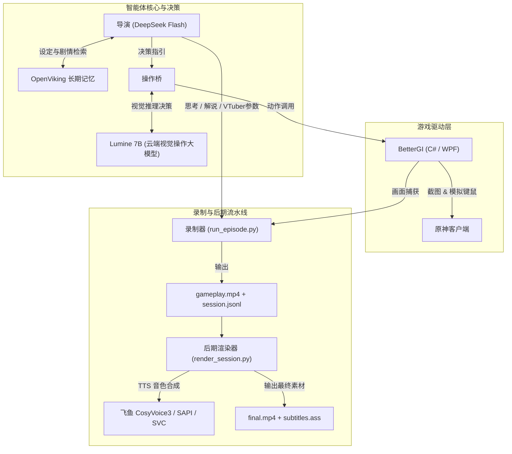

# BetterAGI 实况录制与智能体流水线

[](LICENSE)
[]()
[]()
[]()

> **让大模型「玩」原神，并把整场过程留成可后期成片的素材。不直播、不推流。**

---

## 架构拓扑



---

## 目录结构

```text
BetterAGI/
├── agent/                  # 智能体核心控制流、思考循环、意图管理与 TUI
├── BetterGI/               # 游戏操作与自动化主体（含 C# 源码与 integrations/ 适配层）
│   └── integrations/       # 会话录制、后期渲染、Lumine 桥接驱动
├── player/                 # 持续玩家（Persistent Player）状态机与运行配置
├── Lumine/                 # AutoDL 云端视觉大模型部署与操作协议
├── cosyvoice/              # 飞鱼 CosyVoice3 角色音色离线 TTS 引擎
├── svc/                    # 备选离线 so-vits-svc 声音转换引擎
├── openviking/             # 长期记忆检索系统
├── profiles/               # 智能体设定卡与导演角色配方
├── demo/                   # 端到端录制演示样本与会话资产
├── docs/                   # 系统设计、重构审计与开发指南
├── tools/                  # 联调排查、自动化部署与依赖脚本
├── scripts/                # 常用启动与运行脚本
├── Live2DModel/            # VTuber 虚拟主播形象资产
├── archive/                # 历史演进交付件与参考资料归档（不入库）
├── .gitignore              # 严格的代码与安全过滤策略
├── LICENSE                 # 开源许可协议 (MIT)
└── README.md               # 项目主干指南
```

---

## 快速起步

### 1. 准备配置与安全凭证
流水线默认不内嵌任何访问密钥。开始前需创建对应凭证（相关模板文件见 `*.example.json`）：
* 将 BetterGI 访问令牌保存至 `tools/bettergi_token.txt`；
* 如使用 DeepSeek 导演，准备 `tools/deepseek_key.txt`；
* 复制 `BetterGI/integrations/lumine/director_config.example.json` 为 `director_config.json` 并配置模型参数。

### 2. 录制一场游戏实况

```bash
cd BetterGI/integrations/session

# 仅录制游戏画面与时间线
python run_episode.py --token-file ../../../tools/bettergi_token.txt \
    --duration 1800 --capture window --window-title 原神

# 同时启动导演思考解说与 AutoDL Lumine 操作桥
python run_episode.py --token-file ../../../tools/bettergi_token.txt \
    --duration 1800 \
    --director-config ../lumine/director_config.json \
    --lumine-config ../lumine/bridge_config.json
```

录制完成后将生成 `sessions/<会话ID>/gameplay.mp4` 与 `session.jsonl`：
```bash
python show_session.py sessions/<会话ID> --thoughts --actions
```

### 3. 后期成片与渲染

```bash
# 默认使用飞鱼 CosyVoice3 cute 音色（检测到本地环境自动启用）
python render_session.py sessions/<会话ID>

# 指定角色音色风格
python render_session.py sessions/<会话ID> --tts feiyu --feiyu-style cute
python render_session.py sessions/<会话ID> --tts feiyu --feiyu-style gentle

# 使用 Windows SAPI 语音
python render_session.py sessions/<会话ID> --tts sapi
```

渲染产物包含：
* `final.mp4`：合成配音与画面同步的高清视频；
* `subtitles.ass`：按时间戳对齐的高清特效字幕；
* `render.json`：包含每句解说音频偏移与顺延记录的渲染元数据。

---

## 设计原则与安全边界

1. **外部无侵入性**：全链路仅使用 BetterGI 提供的公开画面采集与虚拟键鼠接口，**不读写游戏内存、不注入任何进程、不修改游戏客户端文件**。
2. **凭据安全与防泄露**：
   * 所有 token、密钥与模型权重已在 `.gitignore` 中进行物理级屏蔽；
   * 会话记录只保留公开的动作时间序列与对白文本，绝不包含敏感通信凭据。
3. **环境隔离**：TTS、变声与视觉模型均采用模块化隔离设计，满足本地独立运行或云端 GPU 桥接部署。

---

## 文档索引

* [系统状态与运行链路](docs/design/system-status.md)
* [从零开始使用手册](docs/使用手册.md)
* [记忆系统设计说明](docs/design/memory-system.md)
* [持续玩家架构重构计划](docs/refactor/README.md)
