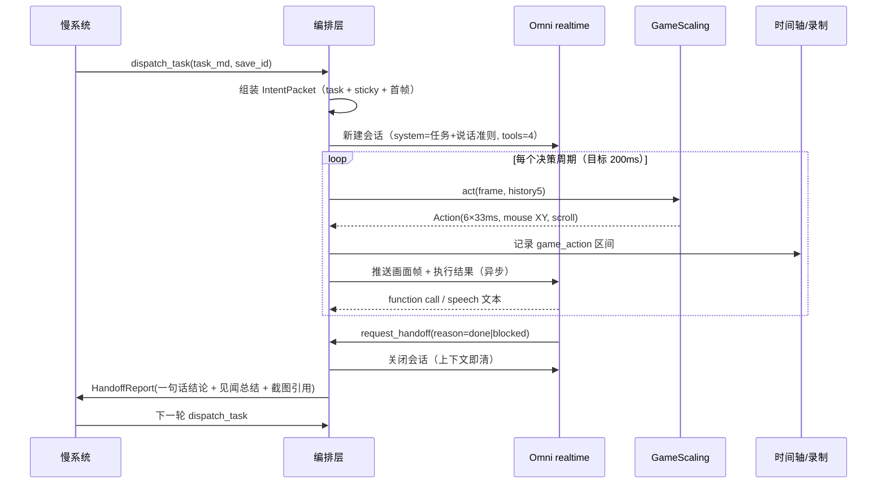

# 01 架构总设计：ProAct 式双系统直播 Agent

> 版本 v1.0 · 2026-11-04 · 依据：ProAct 论文（arXiv:2602.14048v2）+ 现有 agent/ 实现 + 本轮 55 条用户拍板决策（见 00_decisions.md）

## 1. 一句话定位

一个「手在玩、嘴在说、脑子偶尔醒一下」的直播 agent：
**快系统**（Omni realtime + GameScaling 手模型）负责把当前意图执行完并持续说话；
**慢系统**（DeepSeek flash）只在需要时醒来做轻量重规划；
**记忆**（Graphiti + 便利贴）让它在跨会话时像人一样「记得这游戏怎么玩、这个观众是谁、上次卡在哪」。

设计哲学与 ProAct 一致，但把论文的「固定间隔触发」换成**事件驱动触发**（用户明确否定了定时轮询式设计）。

## 2. 分层结构

```
┌──────────────────────────────────────────────────────────────────────┐
│ L5 直播编排层  schedule/save_id/pre-flight/下播流程/排期（人工启动）    │
├──────────────────────────────────────────────────────────────────────┤
│ L4 慢系统（DeepSeek flash）  醒来→读上下文+记忆→出 markdown 任务→交棒   │
│    tools: read_sticky/write_sticky/search_memory/write_memory         │
│           read_danmaku/get_last_episode/dispatch_task/set_hook/set_plan│
├──────────────────────────────────────────────────────────────────────┤
│ L3 快系统   ┌ Omni realtime（云） ┐   ┌ GameScaling 2B-S3（本地卡）┐   │
│            │ 看画面/解说/判结束   │   │ 200ms 动作块 = 6×33ms 键位 │   │
│            │ 受限 tools          │   │ 当前帧+5 历史帧            │   │
│            └────────┬───────────┘   └───────────┬───────────────┘   │
│                     │  events / speech          │ key stream         │
├─────────────────────┼───────────────────────────┼───────────────────┤
│ L2 执行与观测        │ 时间轴 JSON（单调时钟 ms） │ 键位注入（33ms 步）│
│    录播 10min 分片   │ TTS（字数估算→回填）       │ 截屏 5-10Hz        │
├─────────────────────┴───────────────────────────┴───────────────────┤
│ L1 记忆   Graphiti(Neo4j docker)：Episode/实体/边                     │
│           便利贴  sticky/<save_id>.md：key_binding 1K + game_rules 1K │
└──────────────────────────────────────────────────────────────────────┘
```

## 3. 角色与职责（一个部件只做一件事）

| 部件 | 负责 | 明确不负责 |
|---|---|---|
| Omni realtime（快-嘴） | 看画面、解说、判断意图是否该结束、决定插不插话、调受限工具 | 不规划下一件事、不写记忆、不改任务 |
| GameScaling（快-手） | 把「当前这段执行」变成 200ms 键位块 | 不理解任务语义、不知道观众、不判成功 |
| 慢系统 | 读见闻+记忆+弹幕 → 出一句 markdown 任务、写记忆/便利贴、决定接不接弹幕 | 不看画面（只在必要时看交棒带回来的截图）、不能边想边执行 |
| 旁路子代理 | 给快系统提供「参考」或「预规划」，权限低于快系统 | 不能插话、不能改意图、不能发键位 |
| 编排层 | 会话生命周期、互斥、熔断、时间轴、录制、pre-flight | 不做任何语义判断 |

**关键职责分离**：GameScaling 的输入只有「任务文本 + 便利贴 + 画面」，因此便利贴里只有 `key_binding` 与 `game_rules`，**快系统（realtime）不读便利贴**（用户明确：这些数据是发给手模型的，快系统用不上）。快系统的受限工具因此是 note_observation / request_handoff / ask_slow_reference / report_blocked 四件，不含 read_sticky。

## 4. 主时序：一次意图的生命周期

> 本节只画**一次意图**。想看覆盖一场直播全流程（pre-flight → 开播仪式 → 规划 → 派发 → 执行 → 支路 → 卡关 → 交棒 → 下播 → 事故止损，共 9 个阶段）的总图，见 `README.md` 的「全链路时序图（覆盖所有环节）」。



要点：
- **会话每意图一建一毁**（接受 1-3s 冷启，换上下文绝对干净）。
- 手的 `policy.reset()` 在意图开始时调用一次，意图内连续；历史 5 帧跨调用保留。
- 时间轴与录制**始终在跑**，与意图边界正交（意图只是索引）。

## 5. 状态机

```
IDLE ──pre-flight 通过──> PREFLIGHT_OK
PREFLIGHT_OK ──开播话术完成──> PLANNING
PLANNING ──dispatch_task──> EXECUTING
EXECUTING ──request_handoff(done)──> HANDOFF
EXECUTING ──report_blocked / 主观卡住──> HANDOFF
EXECUTING ──ask_slow_reference──> EXECUTING（子代理旁路，不阻塞）
HANDOFF ──见闻总结写盘──> PLANNING
PLANNING ──连续 N 次卡关→开 thinking──> PLANNING_THINKING（画面挂「大肥鱼CPU烧了」）
EXECUTING/HANDOFF ──解析失败/超时熔断──> ABORTED（落账→停推流→事故报告→退进程）
PLANNING/HANDOFF ──到点/人工──> SIGNING_OFF（下播话术→本场 episode 记忆→钩子）
```

不变量：
1. 任一时刻最多一个 realtime 会话存活；旧会话必须**取消**（不是放弃）。
2. 任一时刻慢系统与 realtime 不并发（互斥是设计意图，不是巧合）。
3. 每个意图恰好产生一份 HandoffReport（成功/失败/阻塞都算）。
4. 意图没有硬时限，只有「卡关」判定。

## 6. 快慢互斥与「画面冻结」的处理

用户的选择：慢系统关 thinking、预算 ≤2s、思考期画面完全冻结——这是**故意的**，换取「简单可控」。

| 场景 | 表现 | 实现 |
|---|---|---|
| 正常重规划（<2s） | 画面原地静止 1-2s，像人在看屏幕 | 继续推最后一帧，不说话 |
| 超预算 | 画面中央显示「大肥鱼CPU烧了」 | 编排层 watchdog：900ms 无 token → 贴图，2s → 贴图+该轮降级 |
| 卡关 N 次后开 thinking（5-10s） | 用「发呆」圆场：碎碎念「呃……这个好像不对」 | 允许 TTS 预置发呆台词池 |
| realtime 说话时 | 继续执行（边打边说）但 TTS 触发 ducking | 音频侧自动压低游戏音量 |

**待实测项**：0.8B/2B + vLLM 单步延迟可能只有 150-400ms（主成本是 5 张历史帧 prefill）。因此编排层先打点 p50/p95，再决定要不要双缓冲流水线——**不预先假定慢，也不假定快**。

## 7. 交棒协议

触发条件（全部来自用户拍板）：

| 触发 | 由谁发起 | 结果 |
|---|---|---|
| 意图完成 | realtime 判断画面达成 | request_handoff(done) |
| 执行失败 | realtime 看画面判定失败 | request_handoff(failed) |
| 主观卡住 | realtime report_blocked | request_handoff(blocked) |
| 新场景/新 UI/任务落账 | 慢系统观察到 → 但这些唤醒条件现在由 realtime 交棒承载 | 同上 |
| 观众点单 | **不打断**：执行优先，记下、等当前意图结束再议 | 弹幕进 bit 桶，慢系统下轮读 |

载荷见 `02_schemas.md §3`。**「你说的这些都叫见闻总结」** —— 所以载荷里不再拆字段，统一一段 markdown 见闻总结（含关键状态变化、新信息、残留动作），加一句话结论。好处：慢系统不需要学 schema，坏处：结构化统计要靠后处理（P2 再补 `stats` 侧车字段）。

## 8. 旁路子代理（快系统的「参谋」）

两种模式，都不看画面（只吃快系统给的文本状态）：

| 模式 | 触发 | 输入 | 输出 | 权限 |
|---|---|---|---|---|
| 旁路建议 | 快系统 ask_slow_reference(mode=advise) | 当前状态摘要 | 一段「你可以试试…」参考 | 只能回给快系统，不能插话 |
| 提前规划 | 快系统认为结果可预测 | 已有信息 + 目标 | 下一轮慢系统的规划草稿（可开 thinking） | 有慢系统决策权，可直接决定不进入下一轮慢系统 |

实现要点：子代理跑在**独立协程 + 独立 API key 配额**，结果投递到快系统下一帧的上下文；超时直接丢弃（不阻塞主循环）。

## 9. 记忆：写什么、什么时候写、怎么读

| 层 | 载体 | 生命周期 | 写入时机 |
|---|---|---|---|
| 工作记忆 | 意图内上下文 | 分钟级，意图结束即清 | 不落库 |
| 情景记忆 | Graphiti Episode 节点 | 会话级、可回放 | 每轮落账 |
| 语义记忆 | Graphiti 实体+边 | 跨会话 | 落账时提炼 |
| 程序性记忆 | Graphiti + 便利贴 | 跨会话（最值钱） | 慢系统每次启动可 write_sticky |
| 社交记忆 | Graphiti Viewer 节点 | 跨会话 | 读到弹幕时 |

- **读取**：每轮都注入；query = 当前上下文文本本身（不做 query 生成），向量关联度匹配 + 标签过滤（save_id / 游戏）。
- **预算**：中等，且**不跨会话累积**——记忆是「注入的新鲜副本」，不写回对话历史。
- **写回**：慢系统落账时；两层粒度（episode 一条 + 原子事实若干）。
- **遗忘**：不遗忘，只加权（salience/decay）。
- **防剧透**：靠 prompt 约定「记忆就是全部已知，不许引入记忆外的知识」+ 记忆层只投喂已获得内容（双保险，用户选 1+2，输出审查留作 P1）。

## 10. 时间轴与录制

- **时钟**：本场直播开始的单调毫秒（`t=0`），全部事件用它，不受系统时间调整影响。
- **事件**：播出侧 `speech` / `l2d` / `viewer` 三类（用户明确只要这三类）。离线断言与事故复盘另需控制事件（`intent_start` / `intent_end` / `game_action` / `handoff` / `freeze` / `incident` / `net_reconnect`），与播出事件**同文件、同 `t_ms`**，定义见 02_schemas.md §6.2b；交付剪辑前导出 `timeline_viewer.jsonl` 把控制事件滤掉。
- **录制**：固定 10 分钟一片 mp4，每片首帧写入 `start_ms` 与帧号，时间轴按同一时钟；意图索引单独放 `session_index.json`，不混进事件流。
- **TTS 对齐**：先按字数估时长（约 5.5 字/秒）排区间，TTS 音频回来再回填 `dur_ms` 并向后顺延后续事件（可容忍 200ms 内错位）。

## 11. 弹幕链路

```
弹幕服务（别项目）──HTTP──> 编排层 DanmakuBuffer（环形，最近 500 条）
                              │
                              └─> 只在慢系统 PLANNING 时被 read_danmaku 读取
快系统不看弹幕（避免边说边被带节奏导致手抖）
```

接口（最省事方案，已拍板）：GET /danmaku?since=<ms>&limit=50 → JSONL；GET /stats → 在线/礼物。降级：不可达时记 warning，不阻塞开播（P2 再考虑硬依赖）。

## 12. 故障熔断

用户口径极硬：**手解析失败 = 程序错误**，不是模型问题，所以要留证并下播。

```
parsed=False / truncated / 连续 3 次 no-op
   → 冻结画面（停止发键位）
   → 落账（写 episode + 事故标记）
   → 停推流
   → 写事故报告目录 crash/<ts>_<intent_id>/（请求体/原始回复/解析中间态/帧/时间轴片段/进程状态）
   → 退进程（不再热修重连）
```

其他熔断：Omni 断线 → 静默重连 + 预置台词撑场（这是唯一允许自动恢复的故障）；整体卡死 >60s → 切「休息一下」画面 → 落账 → 重启进程。

## 13. 与 ProAct 的对应关系（为什么这么设计）

| ProAct 要素 | 论文做法 | 本项目落地 | 改动理由 |
|---|---|---|---|
| 双系统 | 快系统连续执行 + 慢系统稀疏介入 | 同，但慢系统由 realtime 工具调用触发 | 论文固定间隔在游戏里会打断操作 |
| Context Encoder | 有界 memory bank，三层每层一句 | Graphiti 五层 + 便利贴 2K | 游戏需要程序性记忆（键位/解法）长期存 |
| Behavior Planner | 非对称窗口规划 | 慢系统只出 markdown 任务，不做行为树 | 手模型（GameScaling）能吃自然语言任务 |
| 五维动机打分 → τ=4 触发 | 打分驱动 | 改为事件触发 + 卡关计数 | 打分需要标注数据，冷启动不可用 |
| 连续 streaming cycles | 连续生成 | 200ms 块 + 33ms 步，与手模型训练分布一致 | 硬件与模型决定 |

## 14. 关键不变量（实现时必须断言）

1. `len(active_realtime_sessions) <= 1`
2. 慢系统运行时 `active_realtime_sessions == 0`
3. 每条键位事件都落在某个 `intent_id` 区间内（否则是 bug）
4. 时间轴事件严格单调不减（`t` 可相等，不可倒退）
5. 便利贴总长 ≤ 2048 字符（超了拒绝写入并回滚）
6. 每个意图结束必然产生 HandoffReport（含 aborted 情况）
7. 录播分片 `start_ms` 与时间轴同源，不允许第二次取时钟
