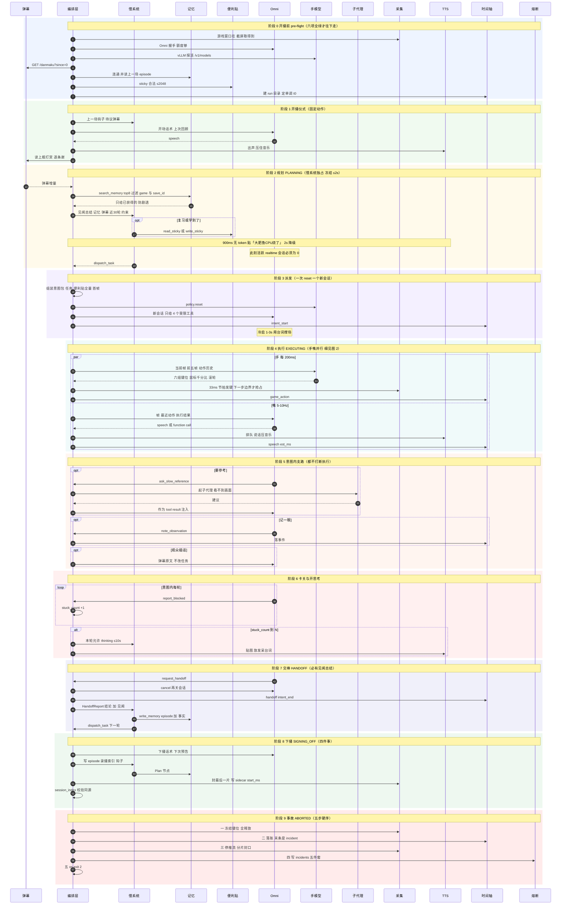
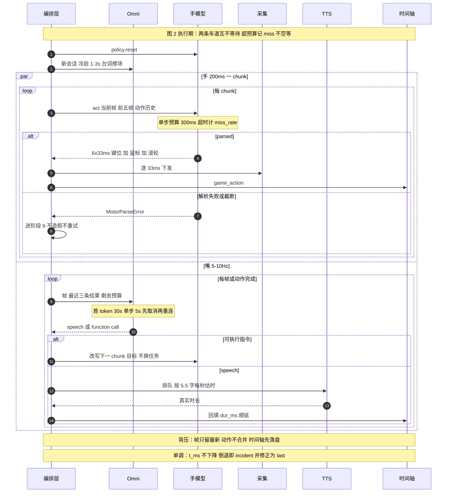

# README · ProAct 式 AI 主播：实现级设计（2026-11-04）

> 一句话：把「Omni realtime 当嘴和眼睛 + GameScaling 2B 当手 + DeepSeek flash 当偶尔醒来的脑子 + Graphiti 当记性」落成一套**能直接开工改代码**的设计，而不是又一份方向性 PPT。

## 这套文档是什么 / 不是什么

| 是 | 不是 |
|---|---|
| 实现级契约：字段、时序、状态机、file:line 级改造点、验收剧本 | 架构畅想、技术选型对比、给领导看的汇报 |
| 基于**用户 55+ 轮拍板**的约束集合（见 00_decisions.md） | 我自己替用户做的产品决策 |
| 对现有 `E:/BetterAGI/agent/` 编排层的改造清单 | 从零重写、新框架、新仓库 |

硬前提（用户口径）：**不改现有代码结构重写**，直接改造 `agent/` 编排层；慢系统模型用 deepseek flash；子代理只用 DeepSeek 供应商。

---

## 目录与阅读路径

| 文件 | 内容 | 什么时候读 |
|---|---|---|
| `01_architecture.md` | 分层、角色职责、主时序 mermaid、状态机、互斥与「画面冻结」、交棒协议、旁路子代理、记忆读写、时间轴与录播、弹幕链路、故障熔断、与 ProAct 论文的对应、7 条不变量 | **先读这个**，建立整体图 |
| `02_schemas.md` | 唯一字段口径：意图包、见闻总结模板、慢系统输出、mailbox 事件+deadline、时间轴、便利贴、Graphiti 节点/边、13 个工具签名、弹幕 API、事故留证 | 写代码前必读；改字段先改这里 |
| `03_code_change_plan.md` | 模块地图（A）、12 行差异表（B）、14 组改造清单带 file:line 与 P0/P1/P2（C）、8 个风险点含分步修法（D）、4 周落地顺序 | 开工时当工单看 |
| `00_decisions.md` | 决策日志：每条决策 + 用户原话 + 影响面；含被推翻/待定项 | 想改设计时先查这里有没有拍过板 |
| `04_acceptance.md` | 三级门槛（能跑/能播/像人）、不变量断言 A1-A9 的位置、13 个演练剧本（S1-S13）、19 项必打点指标、30 分钟人肉自查、回滚止损顺序 | 上线前逐条过；改完 P0 后当回归清单 |

三条推荐路径：

```text
新人 20 分钟：README → 01 §1/§2/§4 → 02 §2/§3 → 03 §0
实现者：      03（工单）→ 02（契约）→ 01 §14（不变量）→ 04（怎么算做完）
评审/自己看： 00（为什么这么定）→ 03 §D（风险）→ 04 §三（演练）
```

---

## 架构一页图

```text
          ┌──────────── 慢系统 DeepSeek flash（≤2s，关 thinking）─────────────┐
          │ 读：见闻总结 + 记忆Top8 + 弹幕 + 最近30轮意图  →  出：一段 markdown 任务 │
          │ 工具：sticky 读写 / 记忆读写 / 弹幕 / 上一场 / dispatch / hook / plan     │
          └───────────────┬──────────────────────────────────────────────────────┘
                          │ dispatch_task（意图包 = 任务 + 便利贴全量 + 首帧）
                          ▼
   ┌──────────── 快系统（每意图新建会话，结束即断）────────────┐
   │  Omni realtime：看画面 5-10Hz / 解说 / 判结束 / 4 个受限工具 │
   │  GameScaling 2B-S3：200ms = 6×33ms 键位 + 鼠标 XY + 滚轮     │
   └───────────────┬───────────────────────────────────────────┘
                   │ request_handoff(done|failed|blocked)
                   ▼
   见闻总结（一句话结论 + 我做了什么/看到/听到/状态/残留）→ 落账 → 下一轮

   并行副产物：时间轴 JSONL（speech/l2d/viewer，本场单调 ms）+ 10 分钟录播分片
   长期记忆：Graphiti（Episode/Fact/Mechanic/Place/Bit/Viewer/Plan/SelfState）
   程序性记忆：便利贴 sticky/<game>/<save_id>.md，key_binding 1K + game_rules 1K
```

## 全链路时序图（覆盖所有环节）

一张图从「开播前自检」走到「事故止损」，9 个阶段全在里面。看不清就复制下面这段 mermaid 源码到 mermaid.live 放大看——图本身就是可编辑的源文件，改流程时先改图再改代码。

阶段编号与 `01_architecture.md` §5 状态机的对应：**0** = `IDLE → PREFLIGHT_OK`；**1–3** = `PLANNING`（1 是首轮开播仪式，3 是 `dispatch_task` 那一刻）；**4–6** = `EXECUTING`（5、6 是执行期内的支路与卡关，不是独立状态）；**7** = `HANDOFF`；**8** = `SIGNING_OFF`；**9** = `ABORTED`（任意状态都可跳入）。

参与者图例：`DM` 弹幕服务 / `O` 编排层（全链路唯一写者）/ `S` 慢系统 DeepSeek flash / `M` Graphiti 记忆 / `K` 便利贴 sticky / `R` Omni realtime（嘴+眼）/ `H` GameScaling 2B（手）/ `P` 旁路子代理 / `C` 采集·推流·录制 / `V` TTS 与渲染 / `T` 时间轴 JSONL / `X` 熔断与事故目录。



**图 2（局部放大，可选读）**：阶段 4 里手、嘴两条车道的精粒度——200ms 一步、5-10Hz 推帧、各等待点的 deadline、以及「超时不空等」的降级路径。



---

## 一页结论：现在这个 loop 的十个硬伤（不修就不能直播）

按严重度排序，全部有 file:line 证据，详见 03 §D：

| # | 硬伤 | 现状证据 | 后果 |
|---|---|---|---|
| 1 | Omni `collect` 的 `while` 里 `recv_json()` **没有超时**，预算用完只 `return` 不取消 | `agent/omni.py:350/359`、`_drain_until_done`(`:293`)/`cancel_inflight`(`:317`) | 上一意图的事件流被下一意图读到 → **跨意图串台**，这是「59% 轮次空转」的根因之一 |
| 2 | 手模型解析失败被当成「合法空动作」继续跑 | `agent/motor.py:215-222` 用 `label_action`(`:52`) 造 6 组假动作 | 模型胡说的状态被当成执行成功，错误会累积 152 次同类 |
| 3 | `policy.reset()` 全仓零调用 | `agent/motor.py:117` 定义，`grep` 无调用点 | 跨意图历史污染，第一帧就带着上一段的动作分布 |
| 4 | 200ms 预算无人守 | `DEFAULT_TIMEOUT`=60s(`agent/motor.py:30`) vs `CHUNK_MS`=200(`agent/gamescaling_action.py:36-41`) | 单步卡 60s，手停下但嘴还在说「我在打」 |
| 5 | 手与嘴只共享 `stop`/`done` 两个 Event | `agent/executor.py:81/147/200` | 无互斥、无时序校验，`decide_ms` 只记不校验 |
| 6 | 9 个工具 0 实现，dispatch 只认 8 个名字 | `agent/agent.py:89/148`、`:1624` | 慢系统没有手脚，只能干说 |
| 7 | 便签有存储、零调用方，且上限是 per-profile 4000 字符 | `agent/profiles.py:236/251` | 程序性记忆不可达，且配额与 1K+1K 不一致 |
| 8 | 弹幕直塞 user 消息 | `agent/tui.py:852-855` | 观众一句话就能改当前任务 → 手抖 |
| 9 | 记忆只写不读、不是五层 | `agent/memory.py:47`（Episode 无 layer/atoms）、`:439`（单值 group_ids） | 「记得这游戏怎么玩」是假的 |
| 10 | 无录播/时间轴产物 | `agent/` 内 `ffmpeg` / `mp4` 零命中 | 只有实时画面，没有可回放、可剪辑、可对账的素材 |

补充一条好消息：三槽位提示词**已经实现**（`agent/prompt_builder.py:365-370`），只需把现成 `PromptBundle.text` 接进 `agent/gamescaling_request.py:104-105`（那里还在拼单条 system 串）。这省掉一整块活儿。

---

## 先做哪三件（第一周的最小闭环）

| 顺序 | 动作 | 完成标志 |
|---|---|---|
| ① | 交棒变成真工具：`request_handoff` / `report_blocked` 真正终止意图并产 HandoffReport | 意图结束必有一份见闻总结落盘，且旧 Omni 会话确认关闭 |
| ② | Omni 超时 + 会话化：每意图一建一毁，`recv_json` 带 deadline，超时**取消**连接 | 连续 100 个意图无串台（时间轴里不存在跨意图的 speech 事件） |
| ③ | 记忆闭环：便利贴 1K+1K 真正拼进手模型 prompt；慢系统能读上一场 | 手模型 system prompt 里能看到三槽；重启后仍能复述上一场结论 |

做完这三件，系统才「可控」；再有 4 周计划（03 §附）才是「像人」。

---

## 与第一轮审计的关系

| 轮次 | 产物 | 结论 |
|---|---|---|
| 第一轮（审计） | `E:/BetterAGI/Docs/analysis/proact-loop-audit-2026-11-04/` | ProAct 内核 = 有界压缩 + 五维打分门控 + 两级去重；我们有三个「假有」（意图总线死代码 / 记忆只写不读 / 便签不可达）；真实会话 59% 轮次空转 |
| 第二轮（本套） | 本目录 | 用 55+ 条用户拍板把「怎么做」钉死：schema、时序、改造点、验收 |

审计文档里的「五维打分 + τ=4 门控」**已被用户否掉**，改为事件驱动（realtime 主观交棒 + 卡关计数）。别拿旧文档当现状。

---

## 关键风险 Top 3

1. **实测未知量**：2B-S3 单步延迟可能 150-400ms 也可能更慢（主成本是 5 张历史帧 prefill）。设计里所有「200ms 流水线」都标注了「先打点再定」——**不要先假定它会快**，也不要为了凑 200ms 提前上双缓冲。
2. **慢系统冻结是故意设计**：思考期画面完全停（≤2s），超了贴「大肥鱼CPU烧了」。这会显得「卡」，但用户明确选了「简单可控」而不是「边想边动」。评审时不要把它当 bug 修。
3. **便利贴配额会互相挤**：1K+1K 是硬顶，模型很容易写超。写入事务必须校验+回滚（02 §7.3），否则一旦写进 3K 文本，手模型的 system prompt 会挤掉历史帧预算，动作质量断崖下跌。

---

## 待实测 / 待定（不许当成已定）

| 项 | 现状 | 谁定 |
|---|---|---|
| GameScaling 单步 p50/p95 | 未测；设计只给了 deadline 归属 | 打点后按实测决定是否双缓冲 |
| Omni 首 token p50/p95（含 1-3s 冷启） | 未测 | 决定「每意图新建会话」是否可接受 |
| 卡关计数阈值 N（开 thinking 的触发） | 未定，建议 3 | 用户/实测 |
| 发呆台词池内容 | 未写 | 人设侧补充 |
| `dispatch_task` 能否不经慢系统直接由提前规划子代理落 | 设计允许，未实现 | 实测后决定 |
| 弹幕服务真实接口是否与 02 §10 完全一致 | 由别项目实现 | 接入时对齐 |

---

## 交付物清单

| 文件 | 行数 | 说明 |
|---|---|---|
| `README.md` | 324 | 本文件（入口，含全链路时序图 ×2） |
| `00_decisions.md` | 379 | 全量决策日志（D01-D124）+ 被推翻项 + 待定项 |
| `01_architecture.md` | 208 | 架构总设计 |
| `02_schemas.md` | 566 | 数据契约与 Schema（含 §6.2b 控制事件） |
| `03_code_change_plan.md` | 511 | 代码地图 + 14 组改造清单 + 8 风险 |
| `04_acceptance.md` | 348 | 三级门槛 + 13 个演练剧本 + 19 项指标 + 止损顺序 |
| `07_errata_measured_latency.md` | 60 | **勘误（必读）**：200ms 是游戏时间不是墙钟；实测 p95 740/1490ms |
| `CHECKSUMS.txt` | — | 全部文件 SHA256 |
| `proact-streamer-2026-11-04.zip` | — | 上述文件打包（保留目录结构） |

---

## 变更记录

| 日期 | 变更 |
|---|---|
| 2026-11-04 | v1.0 首版：由 55+ 轮用户问答 + 现有 `agent/` 代码审计共同产出 |
| 2026-11-04 | v1.0.1 一致性修订：意图包口径统一为「带便利贴全量、但不注入 realtime 上下文」（02 §2.1 样例补 `sticky`、删除未定义的 `landscape` 字段并说明不设完成条件字段）；04 的 L0-1 改回 pre-flight 六项、L0-5 与 A9 判据改为「进模型文本不得含便利贴/记忆正文」；00 的 D51 与 02 §3.3 七段模板对齐 |
| 2026-11-04 | v1.0.3 勘误：新增 `07_errata_measured_latency.md`。5090 真机实测（GameScaling-9B-S3，5 次/档，10/10 parsed）开思考 p50 1155 / p95 1484ms、关思考 p50 696 / p95 735ms；一次决策覆盖 198ms 游戏输入。**原「motor 单步 200ms 墙钟预算」作废**（02 §4 的 `motor_step 300ms`、03 §C.4 的 `deadline_ms=200` 均按 07 的新口径读）；实现已改为 `agent/pacing.py` 给预算，占空比 27%（关思考）/13%（开思考） |
| 2026-11-04 | v1.0.2 加图：新增「全链路时序图（覆盖所有环节）」——图 1 覆盖 9 个阶段（pre-flight → 开播仪式 → 规划 → 派发 → 执行 → 支路 → 卡关 → 交棒 → 下播 → 事故），12 个参与者、autonumber 编号，阶段号与 01 §5 状态机显式对应；图 2 是阶段 4 的局部放大（手 200ms / 嘴 5-10Hz 双车道、各 deadline、超时降级）。两图均用 mermaid 11.17.2 实际渲染校验通过（无语法错误、无溢出） |
