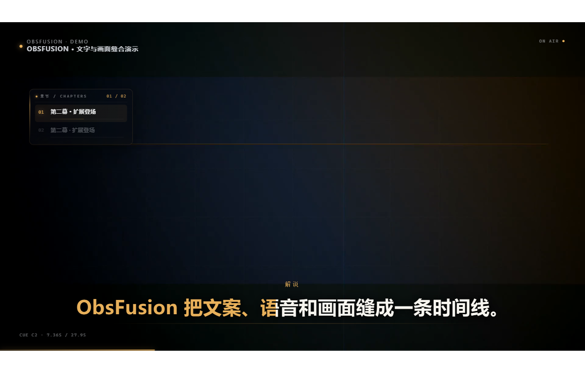
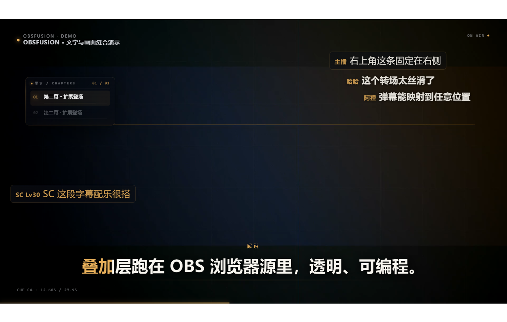
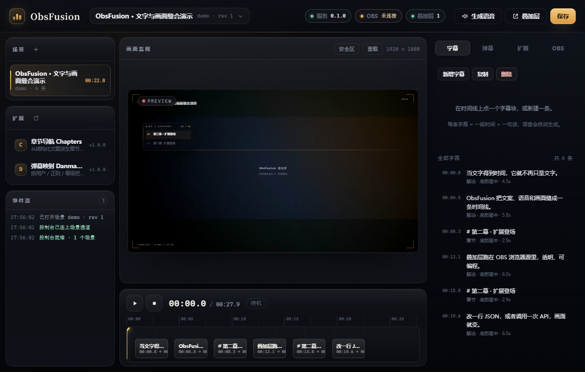
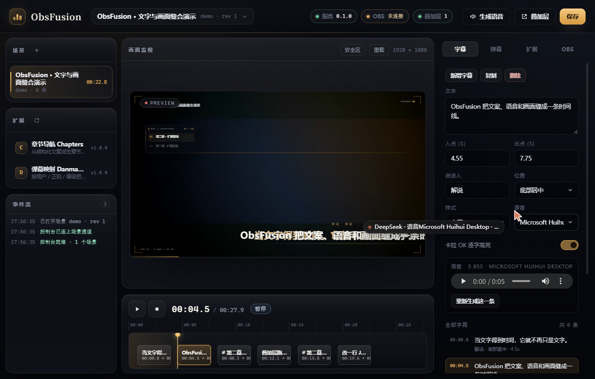

# ObsFusion

**用一份 JSON 文本，驱动 OBS 里的一条视频、一套逐字高亮的中文字幕、一段 TTS 语音，以及各种扩展画出来的图层。**

零依赖、纯 Node ESM 的本地服务：把「结构化时间线」编译成浏览器能直接播的叠加层，你再把这个叠加层当 OBS 浏览器源加进自己的场景。不写 Lua 也能用；写了扩展就能长出新画面元件。

## 1. 它解决什么问题

做带解说的视频，通常要在四个工具之间来回搬：剪辑软件排时间、字幕工具对轴、TTS 工具生成语音、OBS 里再想办法把字叠上去。任何一处改动都要手工同步，语音一长字幕就被裁掉。

ObsFusion 把这四件事压回一份文件：

| 你写的 | 它产出 |
| --- | --- |
| 一条条 `cue`（起止时间 + 文本 + 说话人） | 视频播放 + 字幕出现/消失 + 逐字卡拉 OK 高亮 |
| `cue.tts`（语音、语速、音量） | `projects/<id>/assets/tts/<cueId>.wav` 与时长缓存 |
| `sync.mode = "audio"` | 字幕停留时间按**实际语音时长**自动撑开，不再被裁 |
| `extensions[]`（例如 `danmaku`） | 扩展自己往 `#stage` 里加的图层（弹幕、水印、任何 DOM） |

```
projects/demo/project.json
   │  cues[]: id / start / end / text / speaker / tts
   ▼
compileTimeline()          ← sync.mode=audio 时用 TTS 真实时长重算 displayEnd
   │
   ├─ timeline JSON ─────────────────────► GET /api/projects/demo/timeline
   │                                          │
   │                                          ▼
   │                               web/overlay（HTML 叠加层）
   │                               媒体层 1 · 字幕层 30 · 弹幕层 60 · 安全区 90
   │                                          │  WS /ws?scene=demo&role=overlay
   └─ assets/tts/*.wav + media/*.mp4 ─────────┘
                                              ▼
                                OBS「浏览器源」1920×1080 透明底
```

叠加层就是个普通网页：先 `GET /api/projects/<id>/timeline` 拿编译结果，再用 WebSocket 接收播放指令、项目改动与扩展广播。

### 1.1 实际长什么样

| | |
|---|---|
|  |  |
| 叠加层 1920×1080 透明底：字幕逐字卡拉 OK 高亮，退场后立即让位 | 同一条时间线上，弹幕扩展把 SC 映射到左下、普通弹幕走右上滚动；章节扩展在左侧生成导航条 |
|  |  |
| 控制台：左栏场景/扩展/事件流，中栏实况预览 + 时间线，右栏检查器 | 选中一条 cue 后可直接改文本、入出点、说话人、锚点、样式、语音 |

控制台还包含弹幕面板（[control-03-danmaku.png](docs/shots/control-03-danmaku.png)）、扩展配置面板（[control-04-extensions.png](docs/shots/control-04-extensions.png)）、OBS 面板（[control-05-obs.png](docs/shots/control-05-obs.png)）以及实况预览同步（[control-06-preview.png](docs/shots/control-06-preview.png)：预览里的字幕与控制器时间码逐帧一致）。

## 2. 30 秒上手

### 2.1 环境要求

| 项 | 要求 | 说明 |
| --- | --- | --- |
| Node.js | **>= 22** | `package.json` 里 `engines.node >=22`，代码用到 `import.meta.dirname` 与内置 `WebSocket` |
| 系统 | Windows 10/11 | TTS 走 SAPI（`System.Speech`），通过 `powershell.exe` 调用 |
| 中文语音 | 至少一个 zh-CN SAPI 语音 | 例如 `Microsoft Huihui Desktop`；缺了时该条语音生成失败 |
| ffmpeg | **可选** | 只用于探测 `media/*.mp4` 时长、生成演示视频；没有它 TTS 时长改用 WAV 头解析 |
| OBS | 28+ | 需要浏览器源；想自动建源则要在 OBS 里启用 WebSocket 服务 |

### 2.2 启动

```bash
cd E:\BetterAGI\obsfusion
node bin/obsfusion.mjs serve          # 等价 npm start；npm run dev 固定 --port 8787
node bin/obsfusion.mjs serve --port 8790
node bin/obsfusion.mjs --help        # 只打印用法，不启动服务
node bin/obsfusion.mjs doctor        # 环境体检
```

启动后终端打印五个地址（默认端口 8787，只监听 127.0.0.1）：控制台 `/control`、叠加层 `/overlay/demo`、扩展 `/api/extensions`、健康检查 `/api/health`、OBS 连接状态。第一次跑建议直接用演示工程：

```bash
node bin/obsfusion.mjs demo     # 备齐演示工程（工程 + 示例 mp4 + 6 条语音）并启动服务
```

它自动打开 `/control?project=demo`；加 `--overlay` 会同时打开叠加层预览。

### 2.3 在 OBS 里加浏览器源

1. 来源 → **+** → **浏览器**，命名随意（例如 `ObsFusion Overlay`）；
2. 宽 **1920**、高 **1080**（与 `project.canvas` 一致，OBS 会等比缩放）；
3. URL 填 `http://127.0.0.1:8787/overlay/demo`；
4. **自定义 CSS**：`body { background-color: rgba(0,0,0,0); margin: 0px auto; overflow: hidden; }`；
5. 勾选「通过 OBS 控制音频」（`reroute_audio`），TTS 声音才会进 OBS 混音器；想让语音从 OBS 出声，别勾「关闭源时关闭浏览器」。

叠加层默认透明，安全区只在 `?debug=1` 时显示。

## 3. 三条接入路径

三条路都指向同一个 `/overlay/<projectId>`，任选其一：

1. **控制台**（零安装，先跑通）——`/control` 里点播放、改字幕、发测试弹幕，适合调内容。
2. **OBS Lua 脚本**（推荐日常使用）——`node tools/install-obs.mjs` 装脚本，OBS「工具 → 脚本 → +」加载 `obsfusion.lua`，之后菜单 **ObsFusion: 添加/刷新浏览器源** 一键建源并写死 `?obs=1`、1920×1080、60fps。脚本属性可改端口、项目 ID、源名、宽高、`reroute_audio`。
3. **场景集合导入**——`node tools/install-obs.mjs --scene` 或手动导入 `obs/scene-collection.template.json`，得到配好的场景 + 黑底模板源；黑底源只用于预览，正式推流前要隐藏。

逐步图解、脚本属性表、场景集合字段、obs-websocket 启用方法都在 **[docs/OBS_SETUP.md](docs/OBS_SETUP.md)**，本文不重复。

## 4. project.json 速查

一个工程 = 一个目录：`projects/<id>/project.json` + `media/`（视频）+ `assets/tts/`（语音与 `manifest.json`）。

### 4.1 顶层字段

| 字段 | 类型 | 默认值 | 说明 |
| --- | --- | --- | --- |
| `id` | string | 必填 | 工程 ID，也是 URL 里的 `<projectId>`；只用 `[A-Za-z0-9_-]` |
| `title` | string | `''` | 标题，控制台与 `obsfusion list` 里显示 |
| `canvas` | object | `{width:1920,height:1080}` | 画布尺寸，宽 320–7680、高 240–4320；OBS 浏览器源按它等比缩放 |
| `video` | object | 见说明 | `{src,loop,muted,fit,opacity}`：`src` 相对路径；`loop` 默认 `true`、`muted` 默认 `true`（声音交给 TTS/BGM）；`fit` 取 `cover/contain/fill` 默认 `cover`；`opacity` 0–1 默认 `1` |
| `audio` | object | 见说明 | `{ttsGain,bgm}`：`ttsGain` 0–2 默认 `1`；`bgm` 为 `null` 或 `{src,gain}`（`gain` 默认 `0.18`） |
| `theme` | object | 见说明 | `{accent,subtitleSize,subtitleFont,showSpeaker}`：`accent` 默认 `#E8B05A`；`subtitleSize` 24–160 默认 `64`；`showSpeaker` 默认 `true` |
| `sync` | object | `{mode:"audio",tailPadding:0.25}` | `mode` 取 `audio`（按语音撑开）或 `strict`（严格按 cue 起止）；`tailPadding` 0–3 秒，语音播完后的留白 |
| `cues` | array | `[]` | 字幕条目，见 4.2 |
| `extensions` | array | `[]` | 工程级扩展开关与配置，元素为 `{id,enabled,config}` |
| `meta` | object | `{}` | `{createdAt,updatedAt,description}`，`description` 最长 500 字 |

写入时会做钳制：越界数值夹回区间、`end` 至少比 `start` 大 0.1 秒、`id` 里的非法字符被删、重复 id 自动加 `-2` 后缀。

### 4.2 cue 字段

| 字段 | 类型 | 默认值 | 说明 |
| --- | --- | --- | --- |
| `id` | string | 必填 | 唯一标识，也决定 TTS 文件名 `assets/tts/<id>.wav` |
| `start` | number | 必填 | 出现时间（秒），0–86400 |
| `end` | number | 必填 | 计划消失时间；`sync.mode=audio` 时只是下限 |
| `text` | string | `''` | 字幕正文（最长 8000 字），同时是 TTS 朗读稿 |
| `speaker` | string | `''` | 说话人，`theme.showSpeaker` 为真时显示在字幕上方 |
| `anchor` | string | `bottom-center` | `bottom-center / bottom-left / center / top-center / top-left / top-right` |
| `style` | string | `subtitle` | `subtitle / title / caption / quote` |
| `karaoke` | boolean | `true` | 逐字高亮（琥珀色进度遮罩） |
| `offset` | object | `{x:0,y:0}` | 在 `anchor` 上的额外位移，-1…1，单位是画布比例 |
| `tts` | object | 见说明 | `{enabled,voice,rate,volume}`：`enabled` 默认 `true`；`voice` 默认 `Microsoft Huihui Desktop`；`rate` -10…10；`volume` 0…100 |

最小工程（`projects/hello/project.json`）：

```json
{
  "id": "hello", "title": "最小示例",
  "video": { "src": "media/demo.mp4", "loop": true, "muted": true, "fit": "cover" },
  "theme": { "accent": "#E8B05A", "subtitleSize": 64 },
  "sync": { "mode": "audio", "tailPadding": 0.25 },
  "cues": [
    { "id": "c1", "start": 0.8, "end": 4, "text": "第一句字幕。", "speaker": "解说", "tts": { "voice": "Microsoft Huihui Desktop" } }
  ],
  "extensions": [{ "id": "danmaku", "enabled": true, "config": { "lanes": 6 } }]
}
```

## 5. 字幕与 TTS 的同步语义

### 5.1 displayEnd：字幕什么时候消失

编译时间线时，每条 cue 的实际上屏区间由 `displayEnd` 决定（`server/timeline.mjs:107`）：

```
sync.mode === "audio" 且该条有语音、语音时长 > 0：
    displayEnd = max(cue.end, cue.start + 语音时长 + sync.tailPadding)
否则（strict / 没生成语音）：displayEnd = cue.end
```

也就是 `cue.end` 在 `audio` 模式里退化成「最早消失时间」：语音念得比计划长，字幕自动延长；念得短，也至少停到 `cue.end`。演示工程 `c1` 的真实数据（`start=0.8`、`end=4`、语音 `4.513s`、`tailPadding=0.25`）算出 `max(4, 0.8+4.513+0.25) = 5.563` 秒。整条时间线的 `duration` 取所有 `displayEnd` 的最大值**再加 2 秒**，且不少于 8 秒。

### 5.2 `tts` 字段

| 字段 | 默认 | 作用 |
| --- | --- | --- |
| `enabled` | `true` | 关掉后这条不生成语音，也不参与 `displayEnd` 计算 |
| `voice` | `Microsoft Huihui Desktop` | SAPI 语音全名，必须与系统里安装的完全一致 |
| `rate` | `0` | 语速，-10（慢）…10（快），直接传给 SAPI |
| `volume` | `100` | 音量 0–100 |

语音产物固定落在 `projects/<id>/assets/tts/<cueId>.wav`，缓存键是 `sha1(text|voice|rate|volume)`，记在 `assets/tts/manifest.json`。改文本、改语音、改语速任一项都会重新生成，其余命中缓存直接跳过。

```bash
node bin/obsfusion.mjs tts --project demo            # 只补缺失/过期的，打印「新生成 N 条，跳过 N 条，失败 N 条」
node bin/obsfusion.mjs tts --project demo --force    # 全部重做
```

（控制台里对应「生成语音」，走 `POST /api/projects/:id/tts`。）

### 5.3 怎么选语音

系统里有哪些 SAPI 语音：

```bash
curl http://127.0.0.1:8787/api/voices     # 返回每个语音的 name / culture / gender
node bin/obsfusion.mjs doctor             # 环境体检，会顺带打印语音名单
```

> ⚠️ 0.1.0 的 `doctor` 在读取语音列表处会抛 `TypeError: Cannot read properties of undefined (reading 'length')`（`bin/obsfusion.mjs:136` 把返回的数组当成 `{voices}` 用了）。它修好之前，用上面第 1 条命令或控制台「字幕」面板的语音下拉（数据同样来自 `/api/voices`）。

本机实测只有两个：`Microsoft Huihui Desktop`（zh-CN，女声）与 `Microsoft Zira Desktop`（en-US，女声）。中文工程请写 `Microsoft Huihui Desktop`（装了完整中文语音包的系统还可能有 `Microsoft Yaoyao`、`Microsoft Kangkang`）。写英文语音去念中文，会得到"英文口音硬读汉字"的效果，见 [FAQ Q8](#8-常见问题)。

## 6. HTTP / WS 接口一览

服务只监听 `127.0.0.1`，默认端口 8787。除特别说明外，请求与响应都是 JSON。

### 6.1 HTTP

| 方法 | 路径 | 说明 |
| --- | --- | --- |
| GET | `/api/health` | 健康检查：版本、运行时长、OBS 状态、工程数、已加载扩展 |
| GET | `/api/voices` | 本机 SAPI 语音列表 `{voices, platform}` |
| GET | `/api/projects` | 工程列表 `{projectRoot, projects:[{id,title,cueCount,duration,updatedAt,revision}]}` |
| POST | `/api/projects` | 新建工程，body `{project}`，返回 201 |
| GET | `/api/projects/:id` | 读原始 `project.json` 与 `revision` |
| PUT | `/api/projects/:id` | 整份写入（会校验并钳制），成功后通知所有叠加层重载 |
| DELETE | `/api/projects/:id` | 删除整个工程目录 |
| GET | `/api/projects/:id/timeline` | **编译后**的时间线，叠加层用的就是它 |
| GET/HEAD | `/api/projects/:id/media/*`、`/api/projects/:id/assets/*` | 视频与语音静态文件，支持 `Range`（206） |
| POST | `/api/projects/:id/transport` | 播放控制，body `{action:"play"｜"pause"｜"seek"｜"stop", time}` |
| POST | `/api/projects/:id/tts` | 生成语音，body `{force, cueIds}` |
| POST | `/api/projects/:id/danmaku` | 发一条弹幕，body `{text,user,color,mode,size,level}` |
| GET | `/api/extensions` | 扩展清单（含 `config`、`configSchema`、`error`） |
| PUT | `/api/extensions/:id` | 改扩展开关或配置 `{enabled,config}`，深合并后落盘到 `data/extensions.json` |
| POST | `/api/extensions/:id/reload` | 重载单个扩展的服务端模块 |
| GET | `/api/obs/status` | obs-websocket 连接状态与当前设置 |
| POST | `/api/obs/connect` | 连接，body `{url,password}`，失败返回 502 |
| POST | `/api/obs/disconnect` | 断开 |
| POST | `/api/obs/apply` | 直接在 OBS 里建/更新场景与浏览器源，body `{projectId,sceneName,sourceName,width,height}` |
| ANY | `/x/<extId>/*` | 扩展自定义路由，见 [docs/EXTENSIONS.md](docs/EXTENSIONS.md) |

静态页面：`/` 与 `/control` → 控制台；`/overlay/<id>` → 叠加层（工程不存在返回 404）；`/shared/*`、`/extensions/<id>/*` → 运行时与扩展前端资源。未知的 `/api/*` 统一返回 404 JSON。

### 6.2 WebSocket

```
ws://127.0.0.1:8787/ws?scene=demo&role=overlay     # role 取 overlay 或 control
```

| 方向 | `type` | 载荷 | 说明 |
| --- | --- | --- | --- |
| 服务端 → 客户端 | `hello` | `{role,sceneId,timeline,state,now}` | 连接或订阅后立刻下发当前快照 |
| 服务端 → 客户端 | `state` | `{sceneId,state:{status,time},now}` | 播放状态（`idle/playing/paused`） |
| 服务端 → 客户端 | `event` | `{name,payload,now}` | 扩展广播、`danmaku.add`、`project.save`、`tts.progress`（帧里**不含** sceneId） |
| 服务端 → 客户端 | `reload` | `{sceneId}` | 工程或扩展变化，叠加层应重新拉时间线 |
| 服务端 → 客户端 | `log`、`error` | `{level,message,at}`、`{error,sceneId?}` | 扩展日志（同时存进内存环形缓冲）与错误 |
| 客户端 → 服务端 | `ping` | — | 收到 `pong` |
| 客户端 → 服务端 | `subscribe` | `{scene,role}` | 切换订阅的工程/角色，会补发一次 `hello` |
| 客户端 → 服务端 | `event` | `{name,payload}` | 转成服务端扩展事件 `overlay.event` |
| 客户端 → 服务端 | `transport` | `{action,time}` | 等价于 HTTP `transport`，但**不会**触发扩展的 `state` 事件 |

## 7. 扩展：一切画面元件都是扩展

叠加层本身只负责「媒体 + 字幕 + 安全区」，弹幕、水印、计时器、比分板……**全部是扩展**。一个扩展 = `extensions/<id>/` 下的三件套（`manifest.json` + `server.mjs` + `client.js`）：服务端管数据与路由，浏览器端管画。

内置的 `danmaku` 是最完整的样板，它把一条弹幕按规则映射到「区域 + 模式 + 时长」。配置写在工程的 `extensions[].config` 或控制台「扩展」面板里：

```json
{
  "id": "danmaku",
  "enabled": true,
  "config": {
    "lanes": 6,
    "area": "top",
    "speed": 8,
    "defaultTarget": { "zone": "top", "mode": "scroll", "duration": 8 },
    "routes": [
      { "name": "主播置顶", "when": { "user": "主播" }, "target": { "zone": "top-right", "mode": "fixed", "duration": 6 } },
      { "name": "SC 固定", "when": { "regex": "^SC" }, "target": { "zone": "bottom-left", "mode": "fixed", "duration": 8, "color": "#E8B05A" } }
    ]
  }
}
```

`routes` 自上而下匹配，第一条命中即用；`when` 支持 `user / mode / badge / contains / regex / levelMin / levelMax`；`target.zone` 取 `top / bottom / top-left / top-right / bottom-left / bottom-right / center / mid-left / mid-right / custom`（`custom` 时用归一化 `x`/`y`）；没命中就落到 `defaultTarget`。

外部程序推弹幕，两条入口：

```bash
curl -X POST http://127.0.0.1:8787/api/projects/demo/danmaku -H "content-type: application/json" -d '{"text":"SC 测试弹幕","user":"主播"}'
curl -X POST "http://127.0.0.1:8787/x/danmaku/send" -H "content-type: application/json" -d '{"text":"hi","user":"观众B"}'
```

写自己的扩展、manifest 全字段、服务端 api、能力链、浏览器 ctx、调试与三个可照抄的配方，见 **[docs/EXTENSIONS.md](docs/EXTENSIONS.md)**。

## 8. 常见问题

**Q1 启动报 `EADDRINUSE`，8787 被占了？**
`netstat -ano | findstr :8787` 找到 PID，`taskkill /PID <pid> /F`（常见是上一次 `serve` 没关干净）；或直接换端口：`node bin/obsfusion.mjs serve --port 8790`。

**Q2 OBS 里浏览器源一片黑？**
按顺序排查：① 先在普通浏览器打开 `http://127.0.0.1:8787/overlay/demo`，能播才说明服务正常；② URL 是否写成 `/overlay/<工程ID>`（写错会 404，OBS 只显示黑屏）；③ 自定义 CSS 里把 `body` 背景设为透明；④ 源宽高是否为 1920×1080；⑤ 右键源 → 刷新页面。完整清单见 [docs/OBS_SETUP.md](docs/OBS_SETUP.md)。

**Q3 画面有字幕但没声音？**
TTS 是叠加层里的 `<audio>` 播的，OBS 默认不接管浏览器源的音频。勾上源的「通过 OBS 控制音频（`reroute_audio`）」，再确认混音器里该源没静音、`audio.ttsGain` 不是 0。另外 `video.muted` 默认 `true`，视频本身不出声是设计如此。

**Q4 字幕不跟 TTS 走 / 提前被切掉？**
三种原因：`sync.mode` 还是 `strict`（改成 `audio`）；这条 cue 的语音没生成（跑 `node bin/obsfusion.mjs tts --project <id>`，看是否报 SAPI 错误）；改了文本但语音没重做（缓存键含文本，正常会自动重做，没触发就加 `--force`）。

**Q5 控制台里改了，叠加层没反应？**
字幕改动要点保存（走 `PUT /api/projects/:id`），成功后服务端广播 `reload`，叠加层自动重新拉时间线；若叠加层正在断线重连就收不到，刷新一下 OBS 源。扩展配置改完点「应用配置」；只改 `client.js` 要在 OBS 里刷新页面，改 `server.mjs` 要点「重载扩展」。

**Q6 没装 ffmpeg 能用吗？**
能。ffmpeg 只用于探测 `media/*.mp4` 的真实时长和生成演示视频；没有它时 TTS 时长退回解析 WAV 头，字幕同步照旧。只有 `node bin/obsfusion.mjs demo` 在需要重新生成演示视频时才硬性依赖它。

**Q7 报错说 Node 版本不够？**
`node -v` 必须 ≥ 22（`engines.node` 的要求，代码用到 `import.meta.dirname` 与内置 `WebSocket`）。用 nvm / fnm 切一个新版 LTS 即可。

**Q8 中文被英文语音念成了怪音？**
`tts.voice` 写成了 en-US 的语音（例如 `Microsoft Zira Desktop`）。改成中文语音（`Microsoft Huihui Desktop` 或系统里其他 zh-CN 语音）；系统里没有中文语音就先装 Windows「中文（简体）语音包」，再用 `/api/voices` 确认名单里出现 `zh-CN`。

## 9. 自检与测试

```bash
npm test           # node --test：47 个用例（时间线编译 / 工程读写 / HTTP API / WebSocket / OBS 资产）
npm run doctor     # 环境体检：Node、ffmpeg、SAPI 语音（含中文）、OBS 安装路径、obs-websocket 配置
npm run check      # 关键入口语法检查
```

`npm run doctor` 在本机的实际输出（密码不会打印）：

```
[ok]  Node.js             24.19.0
[ok]  平台                  win32 10.0.26200
[ok]  ffmpeg              ffmpeg version 9.0.2-full_build-www.gyan.dev
[ok]  SAPI 语音             Microsoft Huihui Desktop, Microsoft Zira Desktop
[ok]  中文语音                Microsoft Huihui Desktop
[ok]  OBS 安装              D:\SteamLibrary\steamapps\common\OBS Studio
[!!]  OBS WebSocket 配置    port=4455 enabled=false auth=true
```

`[!!]` 只表示「OBS 里还没打开 WebSocket 服务」，不影响叠加层使用；只有想让控制台一键建源时才需要在 OBS「工具 → WebSocket 服务器设置」里启用。

逐项验收证据（接口实测、浏览器截图、本轮修掉的 13 个缺陷、已知限制）见 **[docs/VERIFICATION.md](docs/VERIFICATION.md)**。

## 10. 目录结构

```
obsfusion/
├─ bin/obsfusion.mjs      CLI：serve / demo / tts / list / doctor / obs:install / version
├─ server/                零依赖服务端
│  ├─ index.mjs           HTTP 路由 + WebSocket 会话 + 静态文件
│  ├─ extensions.mjs      扩展宿主：加载、配置、/x 路由、事件、能力链
│  ├─ timeline.mjs        工程校验、钳制与时间线编译（displayEnd 在这里算）
│  ├─ tts.mjs + tts-sapi.ps1  SAPI 语音生成、缓存、时长探测
│  ├─ obs.mjs             obs-websocket v5 客户端（建场景 / 建浏览器源）
│  └─ store.mjs / ws.mjs / util.mjs   工程读写、WS 帧编解码、通用小工具
├─ web/overlay/           叠加层页面（媒体、字幕、卡拉 OK、安全区）
├─ web/control/           控制台（工程、字幕、弹幕、扩展、OBS 五个面板）
├─ web/shared/            runtime.js（扩展运行时）与 base.css（设计变量）
├─ extensions/danmaku/    弹幕扩展（三件套样板：manifest.json + server.mjs + client.js，其它扩展同构）
├─ extensions/chapters/   章节导航扩展（从 cue 派生章节，证明扩展接口可复用）
├─ projects/demo/         演示工程：project.json、media/demo.mp4、assets/tts/*.wav
├─ obs/                   OBS 侧资产：obsfusion.lua 与场景集合模板
├─ tools/                 install-obs.mjs（装脚本/场景集合）、make-demo.mjs（造演示工程）
├─ docs/                  CONTRACT.md 架构契约 · OBS_SETUP.md 安装 · EXTENSIONS.md 扩展开发 · VERIFICATION.md 验收记录
│  └─ shots/              实机截图：控制台 5 张 + 叠加层 3 张
├─ test/                  node --test 的资产与契约测试
└─ data/                  运行时数据：extensions.json（扩展配置持久化）与扩展 dataDir
```

## 11. 许可

MIT。零第三方运行时依赖——服务端只用 Node 内置模块（`node:http` / `node:fs` / 内置 `WebSocket` / `node:child_process`），浏览器端是原生 ESM + CSS。时间线编译模型与「音频优先」的字幕同步思路来自长视频访谈剪辑的实际流程；视觉基调（墨黑 + 琥珀金 + 冷银）沿用 `docs/CONTRACT.md` 第 9 节的约定。
